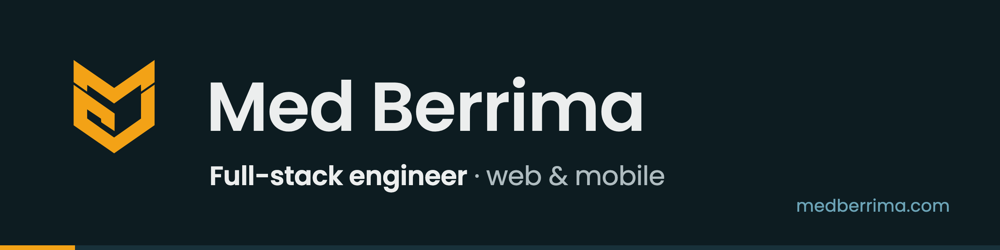

### I build and ship product across web and mobile.

I'm a full-stack engineer in Nabeul, Tunisia (GMT+1). I take web and mobile apps from the first screen to the App Store and Google Play, then keep them running.

**4+ years in production · 14 apps live on the stores · 100k+ downloads on Jayeg**

I've been a full-stack React & React Native developer at Frenchinnov since 2024. I'm open to remote, hybrid and freelance work, and to relocating to Europe or the Gulf.

        

---

#### Now

- **A web ordering kiosk for restaurants** runs on tablet, phone and kiosk from one codebase, with no per-machine updates. It's in testing.
- **[invi.tn](https://invi.tn)** is my own product: digital wedding invitations for Tunisia, built solo in Next.js.
- **[Yaqeen](https://yaqeen.medberrima.com)** is also mine: a Quran & prayer app, plus a web studio that turns a verse into a short video.

#### Selected work

| Product | What I did, and what it changed | Stack |
| --- | --- | --- |
| **FioEat** [App Store](https://apps.apple.com/us/developer/fioeat/id1688703338) · [Google Play](https://play.google.com/store/apps/developer?id=French+innov) | Moved the ordering platform to TypeScript, then to white-label: one codebase and one deploy, with each restaurant's theme, menu and loyalty set from config. **11 brands on the stores, 15+ web shops, −40% customisation requests, −25% dev time.** | React · React Native · Stripe |
| **FioManager** [Web](https://fiomanager.frenchinnov.fr) · [App Store](https://apps.apple.com/tn/app/fio-manager/id6468999195) · [Google Play](https://play.google.com/store/apps/details?id=com.fiomanager) | Restaurant back-office: users, cash closing & accounting (CSV/PDF), invoices, kiosk catalogues and support. Redesigned the mobile app to the new brand without a UI designer. | React · React Native · Firebase |
| **Jayeg** for Orange Tunisie | Started as the only mobile dev, then owned mobile and backend: gamification, audience targeting, campaign back-office, anti-fraud. **100k+ downloads, APIs up to 10× faster** after the MongoDB redesign. | React Native · NestJS · MongoDB |
| **[invi.tn](https://invi.tn)** | Built solo: 40+ templates, multi-day weddings, RSVP from the invite, QR codes, Arabic / French / English. | Next.js |
| **[Yaqeen Muslim](https://play.google.com/store/apps/details?id=com.kinov.yaqeen)** | Full Quran with 27 reciters and synced audio, GPS prayer times with Adhan, Qibla compass, and a verse-to-video creator. | Android |

I've also shipped [Partir En Omra](https://play.google.com/store/apps/details?id=com.partiromra) (Umrah & Hajj companion) and JAZR.IO (field audits), both in React Native. Case studies are at **[medberrima.com](https://www.medberrima.com)**.

<b>Full toolbox</b>

 

| | |
| --- | --- |
| **Mobile** | React Native · Expo · Capacitor · App Store & Google Play publishing |
| **Web** | React · Next.js · TypeScript · Redux · Zustand · Tailwind CSS |
| **Backend & data** | NestJS · Node.js · Express · PostgreSQL · Supabase · MongoDB · MySQL · Firebase |
| **Payments & wallets** | Stripe · Apple Pay · Google Pay · Apple Wallet · Google Wallet |
| **Integrations** | Apple & Google Sign-In · Firebase Analytics · Uber Delivery API · Socket.io · WebRTC |
| **Delivery** | Git · Docker · GitHub Actions · Azure DevOps · Jira · Swagger · Scrum · Figma |
| **AI-assisted dev** | Claude Code · GitHub Copilot · Claude · ChatGPT · Gemini |

**I also design** logos, brand identities and UI, which I've done since 2020. See my work on [Behance](https://www.behance.net/medberrima).

I work in Arabic, French and English.

---

**[medberrima.com](https://www.medberrima.com)** · [CV](https://www.medberrima.com/cv) · [LinkedIn](https://www.linkedin.com/in/medberrima) · [Behance](https://www.behance.net/medberrima) · medberrima0@gmail.com
