<a href="https://www.medberrima.com">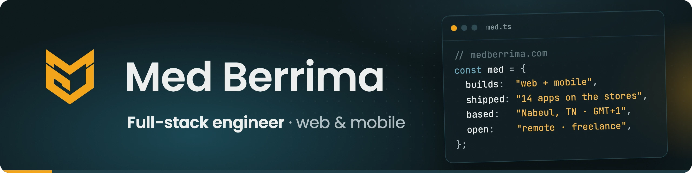</a>

### I build and ship product across web and mobile.

I'm a full-stack engineer in Nabeul, Tunisia (GMT+1). I take web and mobile apps from the first screen to the App Store and Google Play, then keep them running.

**4+ years in production · 14 apps live on the stores · 100k+ downloads on Jayeg**

I've been a full-stack React & React Native developer at Frenchinnov since 2024.

 

        

 

### Now

- **A web ordering kiosk for restaurants** runs on tablet, phone and kiosk from one codebase, with no per-machine updates. It's in testing.
- **[invi.tn](https://invi.tn)** is my own product: digital wedding invitations for Tunisia, built solo in Next.js.
- **[Yaqeen](https://yaqeen.medberrima.com)** is also mine: a Quran & prayer app, plus a web studio that turns a verse into a short video.

 

### Selected work

  <a href="https://play.google.com/store/apps/developer?id=French+innov">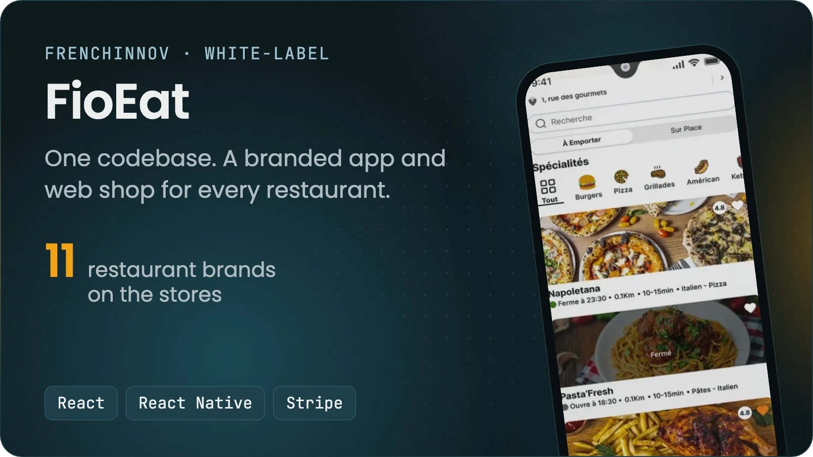</a>
  <a href="https://fiomanager.frenchinnov.fr">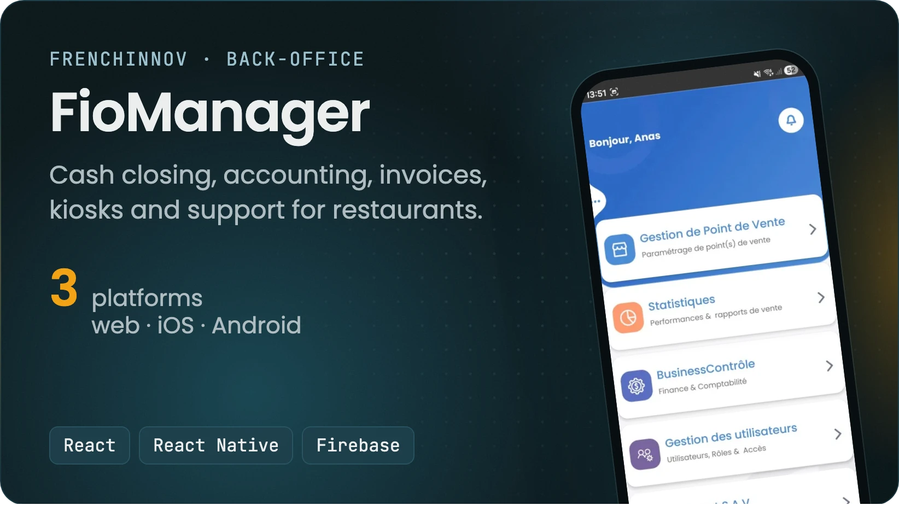</a>

  <a href="https://www.medberrima.com/portfolio">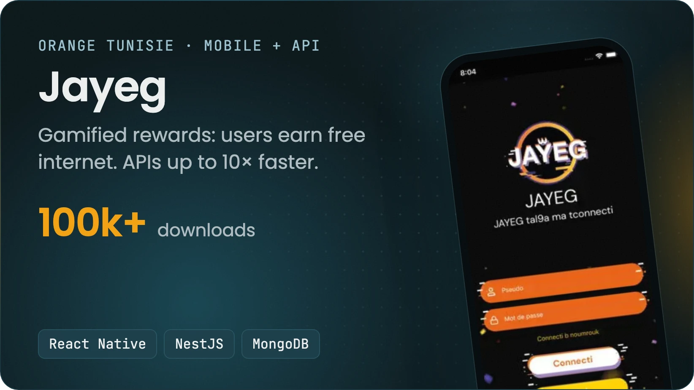</a>
  <a href="https://invi.tn">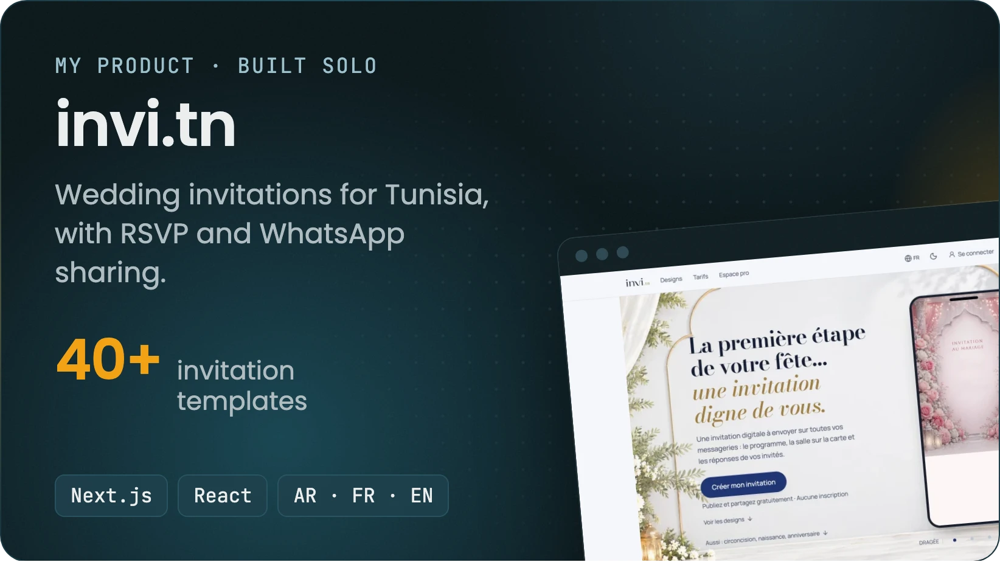</a>

  <a href="https://play.google.com/store/apps/details?id=com.kinov.yaqeen">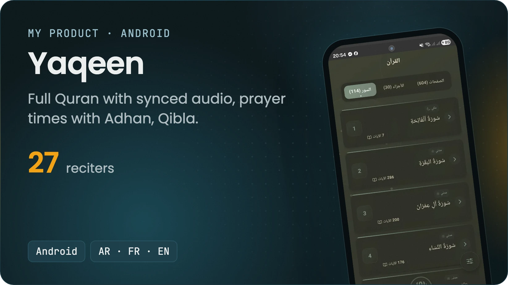</a>
  <a href="https://play.google.com/store/apps/details?id=com.partiromra">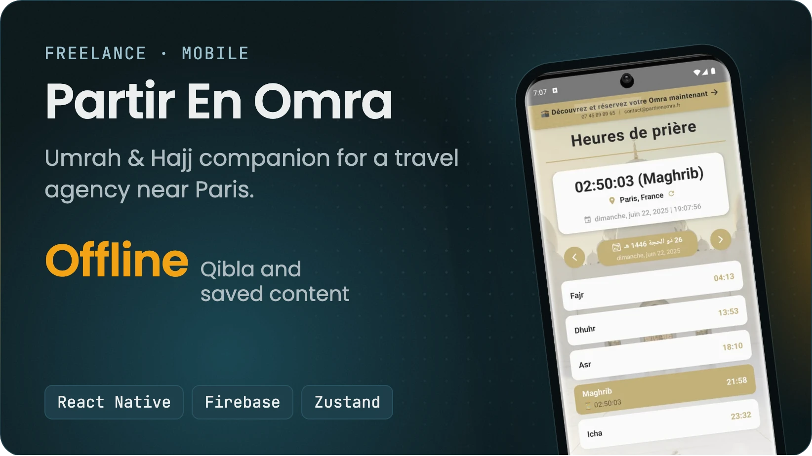</a>

More projects and case studies are on **[medberrima.com/portfolio](https://www.medberrima.com/portfolio)**.

<b>Full toolbox</b>

 

| | |
| --- | --- |
| **Mobile** | React Native · Expo · Capacitor · App Store & Google Play publishing |
| **Web** | React · Next.js · TypeScript · Redux · Zustand · Tailwind CSS |
| **Backend & data** | NestJS · Node.js · Express · PostgreSQL · Supabase · MongoDB · MySQL · Firebase |
| **Payments & wallets** | Stripe · Apple Pay · Google Pay · Apple Wallet · Google Wallet |
| **Integrations** | Apple & Google Sign-In · Firebase Analytics · Uber Delivery API · Socket.io · WebRTC |
| **Delivery** | Git · Docker · GitHub Actions · Azure DevOps · Jira · Swagger · Scrum · Figma |
| **AI-assisted dev** | Claude Code · GitHub Copilot · Claude · ChatGPT · Gemini |

**I also design** logos, brand identities and UI, which I've done since 2020. See my work on [Behance](https://www.behance.net/medberrima). I work in Arabic, French and English.

 

<a href="https://www.medberrima.com">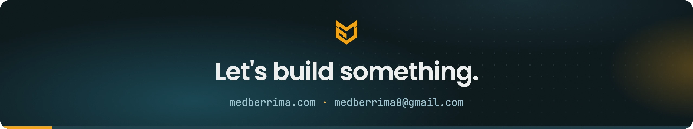</a>

  <a href="https://www.medberrima.com">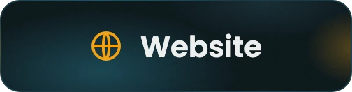</a>
  <a href="https://www.medberrima.com/cv">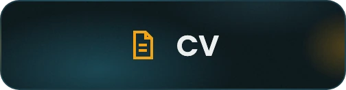</a>
  <a href="https://www.linkedin.com/in/medberrima">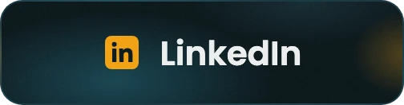</a>
  <a href="https://www.behance.net/medberrima">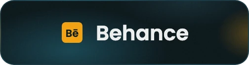</a>
  <a href="mailto:medberrima0@gmail.com">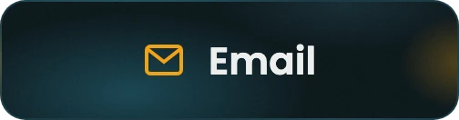</a>

